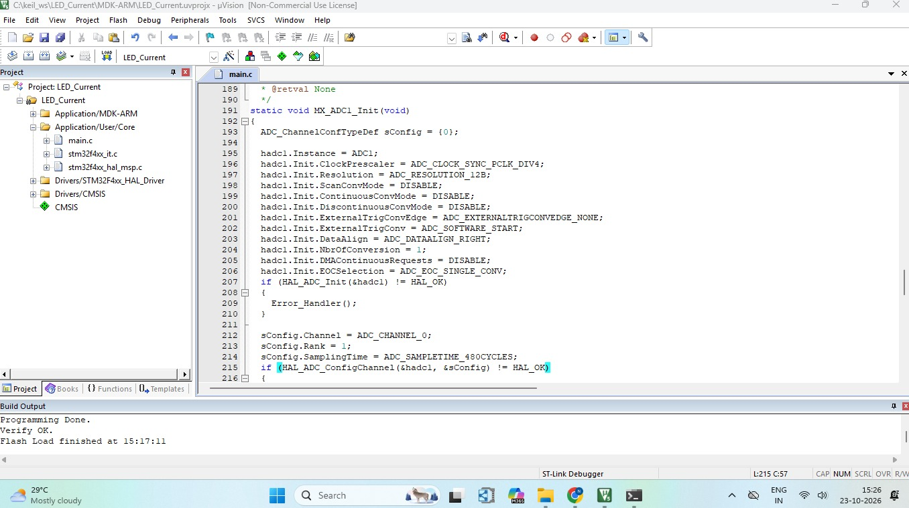

# STM32-ACS712-LED-Current-Monitor

## Project Overview

This project measures the current flowing through an LED using the ACS712 current sensor interfaced with the STM32 NUCLEO-F446RE development board.

The ACS712 sensor detects the current flowing through the circuit and produces an analog output voltage. The STM32 reads this signal through its ADC (Analog-to-Digital Converter), processes the readings, and displays the measured current values in the Windows PowerShell terminal through serial communication.

This project demonstrates current sensing, ADC configuration, Embedded C programming, and hardware-software integration using STM32CubeMX and Keil µVision.

## Hardware and Software Requirements

### Hardware

- STM32 NUCLEO-F446RE development board
- ACS712 current sensor module
- LED
- Breadboard
- Jumper wires
- USB cable for programming and serial communication

### Software

- STM32CubeMX
- Keil µVision
- Windows PowerShell
- ST-LINK Virtual COM Port support, if using the board's USB virtual COM port

## Pin Configuration

| **Component / Signal** | **STM32 NUCLEO-F446RE** |
|---|---|
| ACS712 OUT | Configured ADC input pin |
| ACS712 VCC | According to sensor module specifications |
| ACS712 GND | GND |
| LED | Connected in series with the current-sensing path |
| USART2 TX | PA2, if configured |
| USART2 RX | PA3, if configured |
| UART Baud Rate | 115200, if configured |


## Project Implementation

### 1. Pinout and ADC Configuration

STM32CubeMX is used to configure the ADC input for reading the analog output of the ACS712 current sensor. The required GPIO and communication peripherals are configured according to the project firmware.

The ACS712 current path is connected in series with the LED load to measure the current flowing through the circuit.


### 2. STM32CubeMX Project Manager

STM32CubeMX is used to configure the project settings and generate the initialization code for the STM32F446RE microcontroller and the Keil MDK-ARM toolchain.


### 3. Keil µVision Project Window

The generated project is opened in Keil µVision, where the Embedded C firmware is developed, compiled, and built to read the sensor output, calculate current, and transmit the results to the computer.



### 4. Current Measurement Output in PowerShell

The STM32 processes the ACS712 sensor readings and transmits the measured current values to the computer through the configured serial interface.

Windows PowerShell displays the received measurements in the terminal.

Example output:

```text
LED current meter started
Zero: 2455.1 mV  LED on: 2436.7 mV  LED current: -99.7 mA
Zero: 2455.4 mV  LED on: 2436.8 mV  LED current: -100.6 mA
Zero: 2455.1 mV  LED on: 2437.1 mV  LED current: -97.3 mA

```

**Output explanation:**

- **Zero (mV):** Sensor output voltage measured during the zero-current reference or calibration stage.
- **LED on (mV):** Sensor output voltage measured while the LED circuit is powered.
- **LED current (mA):** Current calculated by the STM32 firmware from the sensor voltage readings.


#### PowerShell Command

If the firmware transmits newline-terminated data through a serial COM port, use the following PowerShell commands:

```powershell
$p = New-Object System.IO.Ports.SerialPort COM26,115200,None,8,one
$p.Open()
while ($true) {
    $p.ReadLine()
}
```

**Command explanation:**

- `COM26` — Replace this with the actual COM port assigned to your STM32 board.
- `115200` — Baud rate; must match the firmware.
- `None` — No parity.
- `8` — Eight data bits.
- `one` — One stop bit.
- `$p.ReadLine()` — Reads incoming data one line at a time.

Close any other serial monitor using the same COM port before running this command. Press `Ctrl+C` to stop the loop.


### 5. Hardware Setup

The hardware setup consists of the STM32 NUCLEO-F446RE development board, ACS712 current sensor, LED, breadboard, and jumper wires.

The sensor measures the current flowing through the LED circuit, and the STM32 processes the readings for display in the PowerShell terminal.


## Demonstration Video

Watch the demonstration video to see the hardware setup, current sensing process, and current readings displayed in PowerShell.

[**▶ Watch the Current Monitor Demonstration Video**](https://drive.google.com/file/d/1gJ69MCSJbiD3FrU9ZFpZr8SDKFMg3ojM/view)

*Make sure the Google Drive video's sharing permission allows viewers with the link to access it.*

## Key Concepts Learned

- ACS712 current sensor interfacing
- STM32 ADC configuration and analog signal acquisition
- Embedded C programming using STM32 HAL
- ADC reading and current calculation
- UART serial communication
- Displaying sensor readings using Windows PowerShell
- STM32CubeMX peripheral configuration
- Keil µVision project development
- Hardware and software integration
- Sensor calibration and measurement accuracy

## Conclusion

This project demonstrates how the ACS712 current sensor can be interfaced with the STM32 NUCLEO-F446RE to measure current flowing through an LED. The STM32 reads the analog sensor output, processes the measurement, and transmits the results to a computer for display in PowerShell.

The project provides practical experience in current sensing, ADC-based measurement, Embedded C programming, and microcontroller-to-computer communication.

## Future Improvements

- Add an LCD or OLED display for standalone monitoring.
- Measure voltage and calculate electrical power.
- Implement overcurrent detection and alerts.
- Improve measurement accuracy using calibration and filtering.
- Log current measurements for further analysis.
